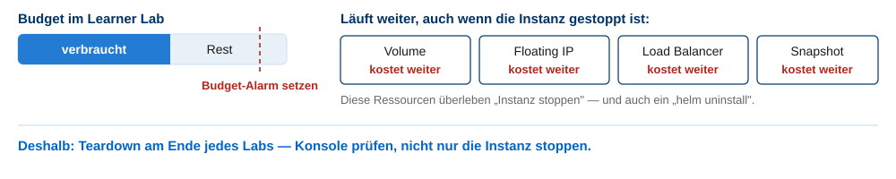

<!-- _class: title -->

# Cloud Services

## Kapitel 0 · Organisatorisches

Wintersemester 2026/2027
Bachelor AI – Hochschule Fulda
Sebastian Rieger · MMNet

---

## Dozent

**Sebastian Rieger**
Professur „Multimediale Kommunikationsnetze"

sebastian.rieger@informatik.hs-fulda.de
Raum 46 (E) 126 · Telefon -3116
Sprechstunde: Do 11:40–13:10 (Anmeldung erwünscht)

**Forschung (MMNet):** Network Digital Twins · Future Internet Architectures · AI/ML in Networking
→ [mmnet.informatik.hs-fulda.de](https://mmnet.informatik.hs-fulda.de)

**Teaching Assistant:** Michael Johann Rittmeister michael-johann.rittmeister@informatik.hs-fulda.de
    

**Werdegang:**

- Studium Angewandte Informatik, HS Fulda (1998–2003)
- Wiss. Mitarbeiter GWDG Göttingen (2003–2010), Promotion Uni Göttingen (2007)
- Projekt-/Abteilungsleiter SCC, KIT Karlsruhe (2010–2012)
- Lehraufträge: HS Fulda, HAWK, HS Karlsruhe, Uni Göttingen
- **Seit 2012: Professur HS Fulda**

> Beispiele und Erfahrungen aus dem Betrieb wissenschaftlicher Rechenzentren fließen in die Veranstaltung ein – Abschlussarbeiten in diesem Bereich sind willkommen.

---

## Modul und Abgabe

| | |
|---|---|
| **Modul** | AI1034 · Cloud Services (früher: Internet Services) |
| **Umfang** | 4 SWS · **5 ECTS** · 2 Termine pro Woche à 90 min (SU + Praktikum) |
| **Voraussetzungen** | keine formalen |
| **Sprache** | Deutsch (Materialien teilweise englisch) |

**Abgabe:** **IaC-Code als Repo oder Archiv** — Infrastruktur, Deployment und Betrieb Ihres Dienstes, nachvollziehbar dokumentiert (README, Architekturdiagramm, Betriebshinweise).

**Abgabefrist: 28.02.2027** (Ende der Prüfungsphase, vor der vorlesungsfreien Zeit)

**Bestehensgrenze**
Mindestens **5 der 6 in den Labs vermittelten Kerninhalte für Cloud Services** umgesetzt

**Extra Credit**
Add-ons: Auto-Scaling · HA/Self-Healing · Backup/DR

> **→ umsetzen in:** W2 Ihr Projekt-Repo anlegen und ab dann durchgehend pflegen.

---

## Die Lehrveranstaltung als Praktikum

Sie bauen in Teams einen eigenen Cloud-Service und betreiben ihn auf echter Infrastruktur.

| Lab | Thema | Kern-Tools |
|---|---|---|
| 1 | Containerisierung | Docker, compose, Registry |
| 2 | Cloud | OpenStack (NetLab), AWS Academy, cloud-init |
| 3 | Scripting & IaC | cloud-init, Terraform |
| 4 | Orchestrierung | Kubernetes (RKE2), Helm |
| 5 | CI/CD & GitOps | GitHub Actions, Argo CD |
| 6 | Monitoring & Observability | Prometheus, Grafana, Loki |
| – | Add-ons (Bonus) | z.B. HPA + k6, Probes/PDB, Velero, ... |

💡 Alle Beispiele und Lab-Aufgaben: [github.com/srieger1/cloud-services-examples](https://github.com/srieger1/cloud-services-examples)

---

## Wie wir arbeiten

**Block A · 90 min — Verstehen und Diskutieren**

- Rückblick und eine Denkfrage
- Impuls (12–16 Folien), endet mit einer Handlung
- Übung oder moderierte Diskussion
- Lab-Intro am Ende des Blocks

**Block B · 90 min — Bauen und Betreuen**

- 15 min geführter Einstieg (alle machen dasselbe)
- 60 min Projektarbeit mit Betreuung
- 15 min Zwischenstand und Blocker
- Rundgänge in W7, W12, W14

- **Die Themen sind fordernd** — das ist gewollt. Wer voraus ist, bekommt Deep-Dives; wer neu einsteigt, bekommt Grundlagen-Kästen und geführte Einstiege.
- **Fragen sind erwünscht**, im Plenum wie in der Sprechstunde; Ihre Praxiserfahrung aus Jobs und eigenen Clustern ist ausdrücklich willkommen.

🧠 Wo im Projekt sehen Sie für sich den größten Lernhebel in diesem Semester?

---

## Semesterplan (14 Wochen)

| Woche | Block A – Input | Block B – Projektarbeit |
|---|---|---|
| W1–W2 | Organisation, Grundlagen, Story, Lab 1 | Gruppen, Ideen, Repo, Docker |
| W3 | **Konferenzwoche:** Flipped-Classroom-Auftrag (1 Seite) | eigenständiges Arbeiten |
| W4–W6 | Grundlagen fertig, Infrastruktur, Anforderungen, Lab 2–3 | Cloud-Instanz, IaC |
| W7–W12 | Labs 4–6, Doku, Monitoring | Kubernetes, CI/CD, Observability |
| W13 | Backup & Recovery, Referenzprojekt, Ausblick | Bonus-Track, Abgabevorbereitung |
| W14 | Offene Fragen, Evaluation | **Rundgang 3**, Galerie, Abgabevorbereitung |

- **Rundgänge** (je Gruppe ~10 min, jede Person erklärt ihren Teil): W7, W12, W14
- **Status-Update** vor jedem Rundgang: was läuft, was fehlt, wo hängen wir
- **Abgabe der Ausarbeitung:** **28.02.2027** (Ende der Prüfungsphase, vor der vorlesungsfreien Zeit) — Abgabeort und Format über **Moodle**
- Alle Termine und Fristen: **Moodle** (zu Beginn der Lehrveranstaltung verbindlich bekanntgegeben)

> **→ umsetzen in:** Agenda und Abgabetermine in Moodle verfolgen; Status-Updates pünktlich abgeben.

---

## Was hier bewusst nicht dran ist

Diese Lehrveranstaltung ist auf die **Umsetzung eigener Cloud-Services** ausgerichtet. Deshalb bleiben bewusst außen vor:

| Nicht Teil der Veranstaltung | Stattdessen |
|---|---|
| Security als eigenständiges Thema (Bedrohungsmodelle, Pentesting, Krypto) | Anwendungsbezogen: „worauf beim Betrieb achten" + Lab-Bezug (Secrets, Image-Scan, RBAC). **z.B. Inhalt bei Prof. Zohner - IT-Sicherheit und Wissenschaftliches Arbeiten im Bereich IT-Sicherheit** |
| AAA/IDM (LDAP, Kerberos, SSO, RADIUS) | OIDC/Keycloak als Option, wenn Ihr Dienst Anmeldung braucht |
| Netz-/Storage-Tiefe (VLAN, IPAM, RAID-Level, SAN-Fabric) | LVA Kommunikationsnetze und -protokolle, Betriebssysteme, Verteilte Systeme; hier nur die Cloud-Sicht |
| Rechts-/Compliance-Details, Kostenverrechnung, Projektmanagement-Theorie | Verweise bzw. andere Module |

🧠 Muss eine Veranstaltung alles abdecken — oder ist eine klare Auswahl mit benannter Lücke besser?

---

## Plattformen und Zugänge

**Private Cloud: NetLab (OpenStack)**

- [private-cloud.informatik.hs-fulda.de](https://private-cloud.informatik.hs-fulda.de)
- Zugang nur im NetLab oder über das **NetLab-VPN**
- Kostenfrei, aber **geteilte Ressourcen** — sparsam wirtschaften
- Floating-IP-Adressen aus `10.32.4.0/22`

**AWS Academy (Public Cloud)**

- Learner Lab, Zugang über Moodle, 50 USD Guthaben
- Sandbox, wird am Semesterende gelöscht

**Ihr Projekt-Repo**

- Git-Repo (GitHub/GitLab) ab W2 — Abgabe erfolgt daraus
- Struktur: `infra/`, `k8s/`, `app/`, `docs/`
- README mit Architekturdiagramm gehört zur Bewertung

💡 Beispiele: [cloud-services-examples](https://github.com/srieger1/cloud-services-examples) · [terraform-openstack-rke2](https://github.com/srieger1/terraform-openstack-rke2)

> **→ umsetzen in:** W2 — Zugänge testen, Repo anlegen, Docker installieren.

---

## Welche Rolle passt zu mir?

Typische Anforderungen in Stellenanzeigen für Cloud-/DevOps-Engineering (**Siehe z.B. Heise Jobs, stepstone, jobpilot ...**):

| Technologie | Stack/Tools |
|---|---|
| Containerisierung | docker, podman, buildah |
| Cloud | OpenStack, AWS, Azure, GCP |
| Scripting (API) | Python, shell/bash |
| IaC | Terraform, Ansible |
| Orchestrierung | Kubernetes, Helm |
| CI/CD & GitOps | GitLab CI, GitHub Actions, Argo CD, Flux |
| Monitoring & Observability | Prometheus, Grafana, Loki |

**Optional/vertiefend:** Auto-Scaling, High Availability, Backup & DR

🧠 Welche Rolle liegt Ihnen näher — Development, Betrieb, Plattform, SRE? Was Sie in diesem Semester bauen, zahlt auf alle vier ein.

---

## Diskussion

**Welche Cloud-/Internetdienste kennen bzw. nutzen Sie — und welche Erfahrungen haben Sie damit gemacht?**

**Welche Dienste betreiben Sie selbst, haben Sie betrieben oder planen Sie zu betreiben?**

**Wer von Ihnen kennt bereits …?**

- Virtualisierung (VMware, KVM) · Cloud (AWS, Azure, GCP, OpenStack)
- Container (Docker, podman) · Kubernetes · Helm
- Configuration Management (cloud-init, Ansible) · Infrastructure as Code (Terraform)
- DevOps · GitOps · SRE · Platform Engineering
- Initiativen: OpenInfra, CNCF, Sovereign Cloud Stack

> Unterschiedliche Vorkenntnisse sind normal — und ausdrücklich erwünscht. Wir nutzen sie für Diskussionen, in denen beide Perspektiven Platz haben.

---

## ⚠️ Cloud-Ressourcen kosten Geld

- Cloud-Ressourcen laufen auf **realer Hardware** — es entstehen **echte Kosten**.
- **Sie sind verantwortlich** für Kosten und Daten in Ihrem Cloud-Projekt.
- **Starten Sie nur, was Sie brauchen. Überwachen Sie Ihre Ausgaben. Löschen Sie Ressourcen sofort nach Nutzung.**
- Auch in der Sandbox gilt: Instanzen werden gestoppt, aber z. B. RDS, ELB, NAT und Elastic IPs laufen weiter.
- Volumes und Load Balancer überleben ein `helm uninstall` bzw. `terraform destroy` oft — prüfen Sie die Konsole.

**→ umsetzen in:** jedes Lab endet mit einem Teardown-Schritt (siehe Lab-Decks).

---

## Was Sie am Ende können

- Einen Internetdienst **planen, containerisieren, deployen und betreiben**
- Infrastruktur **als Code** beschreiben und reproduzierbar bereitstellen (Terraform, cloud-init)
- Den Dienst auf einer **Container-Plattform** betreiben, skalieren und aktualisieren (Kubernetes, Helm, CI/CD)
- Betrieb absichern: **Monitoring, Logging, Alarme, Backup/Restore**
- Projektarbeit im Team organisieren, Entscheidungen begründen und **nachvollziehbar dokumentieren**

 

💡 Abschlussarbeiten und Projekte am MMNet sind willkommen: [mmnet.informatik.hs-fulda.de](https://mmnet.informatik.hs-fulda.de)

 

🧠 Was wollen Sie in diesem Semester ausprobieren, das Sie noch nie gemacht haben?
