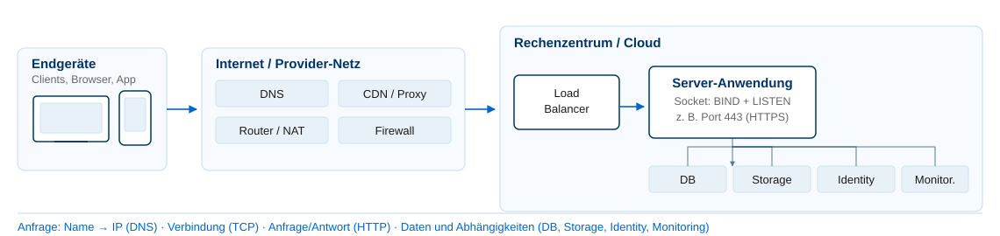
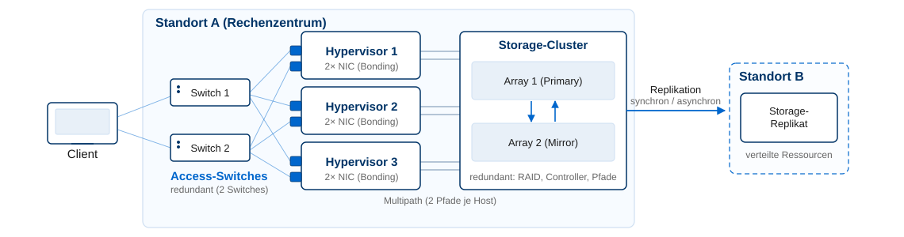

<!-- _class: title -->

# Grundlagen

## Kapitel 1

Wintersemester 2026/2027
Bachelor AI – Hochschule Fulda
Sebastian Rieger · MMNet

---

## Kapitelübersicht

1. **Was ist ein Cloud- oder Internetdienst?** – Definition, Abgrenzung, Cloud-Charakteristika
2. **Bereitstellung und Betrieb** – Architektur, Modelle und Realität
3. **Infrastruktur** – Virtualisierung, Redundanz und was der Provider leistet
4. **IT-Sourcing** – Eigenbetrieb, Hosting, Cloud
5. **Ihr Projekt** – Weg vom Elevator-Pitch zur Abgabe

---

## Lernziele

Nach diesem Kapitel sollten Sie wissen…

- Was ein **Internetdienst** und was ein **Cloud-Service** ist — und wo die Abgrenzung schwierig wird
- Welche **Cloud-Charakteristika** (NIST) und **Service-/Deployment-Modelle** es gibt
- Wie die **Struktur** realer Internetdienste aussieht (Modell vs. Middleboxes, Sockets)
- Welche **Infrastruktur** ein Dienst benötigt und was **Virtualisierung/Redundanz** leisten
- Welche **IT-Sourcing-Optionen** existieren und wie man sie abwägt

> **Ziel:** Sie können Ihren Dienst in das Modell „Anwendung + Infrastruktur + Betrieb" einordnen und eine Sourcing-Entscheidung begründen.

---

<!-- _class: section-break -->

# Teil 1

Was ist ein Cloud- oder Internetdienst?

---

## Was ist ein Internetdienst?

**Definition (stufenweise präzisiert):**

- „Ein Dienst, der über das Internet bereitgestellt wird" → zu unpräzise
- „…über das Internet Protocol (mit geeignetem Transportprotokoll) bereitgestellt" → besser, aber: was heißt „bereitgestellt"?
- Technisch präzise: **eine Anwendung bindet sich an einen Socket und lauscht auf Anfragen** → `BIND` und `LISTEN`

🧠 Ist ein Dienst im eigenen LAN ohne Internetzugang noch ein Internetdienst?

> **→ umsetzen in:** Lab 1/2 — Ihren Dienst als erreichbaren Socket bereitstellen.

---

## Was ist ein Cloud-Service?

Vom verteilten System zur Cloud:

> „Ein verteiltes System ist ein System, mit dem ich nicht arbeiten kann, weil irgendein Rechner abgestürzt ist, von dem ich nicht einmal weiß, dass es ihn überhaupt gibt." — Leslie Lamport

- Cloud = **verteiltes System** auf geteilter Infrastruktur, betrieben in **Availability Zones** (Rechenzentren) innerhalb von **Regions**, z. B. bei AWS

**Definition nach NIST:**

| Bereich | Ausprägungen |
|---|---|
| **Charakteristika** | On-Demand Self-Service · Rapid Elasticity · Resource Pooling · Broad Network Access · Measured Service |
| **Service-Modelle** | IaaS · PaaS · SaaS · FaaS |
| **Deployment-Modelle** | Public · Private · Community · Hybrid (+ Multi-Cloud aus Nutzersicht) |

> **→ umsetzen in:** Lab 2 — dieselbe Instanz in OpenStack (private) und AWS (public) starten.

---

## Story: „Mal eben schnell … schleichend im Betrieb"

Ein Dienst entsteht nebenbei — kein Konzept, keine Tests, kein Monitoring, keine Betriebsübergabe. Er läuft ja.

Wochen später fällt er bei einem Neustart aus. Der Anruf kommt nicht aus dem Projekt, sondern aus der Chefetage: Die halbe Abteilung arbeitet inzwischen damit. Die Verfügbarkeit hatte sich herumgesprochen — Last und Abhängigkeiten sind unbemerkt entstanden, für einen Dienst, der weder sicher noch stabil betrieben wird.

**Merker:**
- **Herausforderung:** Nutzung und Abhängigkeiten wachsen schneller als die Absicherung — „läuft ja" ist kein Betriebskonzept.
- **Konsequenz:** Bereitstellung endet nicht mit der Installation: Updates, Backup, Monitoring und Zuständigkeit gehören dazu.

🧠 Welcher Dienst in Ihrem Umfeld läuft heute „mal eben schnell" — und wer bekommt den Anruf, wenn er ausfällt?

<!--
Story-Template (Vorlage für alle Story-Folien, D14):
1) Keyword aus der Kategorie wählen: „mal eben schnell … schleichend im Betrieb" oder „mal eben schnell … sicher kaputt".
2) 2-4 Sätze Erzählung (anonymisiert, ohne Firmennamen, ohne Zahlen, die nicht belegt sind).
3) Zwei Merker: Herausforderung / Konsequenz — bewusst kurz, ein Bullet je Punkt.
4) Genau eine 🧠-Frage am Ende, die auf die Studierenden zeigt.
Optional: dieselbe Zwei-Punkte-Struktur (Problem/Herausforderung + Lösung) als Galerie-Beitrag im Repo (§6.7).
-->

---

## Cloud-Native – in a nutshell

**Definition (CNCF):** Anwendungen, die für die Cloud **entworfen** wurden und deren Eigenschaften optimal nutzen
→ [CNCF Definition](https://github.com/cncf/toc/blob/main/DEFINITION.md)

- Entwurf/Entwicklung **speziell für die Cloud** — erfüllt Elastizität, Fehlertoleranz, Messbarkeit
- Optimale Nutzung verfügbarer Cloud-Dienste (verwalteter Speicher, Queues, verwaltete Datenbanken)
- **Starke Automatisierung:** CI/CD, Infrastructure as Code, GitOps
- **Nachteil:** Legacy-Anwendungen müssen dafür umgebaut werden

> Die Komplexität des Umfelds wächst ständig — vgl. [CNCF Landscape](https://landscape.cncf.io/) und [Trail Map](https://github.com/cncf/trailmap). Wir konzentrieren uns auf die für den Betrieb wesentlichen Bausteine.

🧠 Wann ist „cloud-native" eine echte Eigenschaft — und wann nur Marketing?

> **→ umsetzen in:** Labs 1, 4, 5 — Container, Plattform, Pipeline.

---

<!-- _class: section-break -->

# Teil 2

Bereitstellung und Betrieb

---

## Modell und Realität

| Layer | Bezeichnung | Bezug zum Internetdienst |
|---|---|---|
| 7 | Anwendung | HTTP(S), DNS, SMTP — hier lebt der Dienst |
| 6 | Darstellung | Kodierung, Verschlüsselung (TLS), Kompression |
| 5 | Sitzung | Sitzungsverwaltung, Sockets |
| 4 | Transport | TCP/UDP — Ports, Zuverlässigkeit, Flusskontrolle |
| 3 | Vermittlung | IP-Adressen, Routing |
| 2 | Sicherung | Ethernet/WLAN, MAC-Adressen |
| 1 | Bitübertragung | Kabel, Funk, Signale |

**In der Realität ist der Dienst nie isoliert:**

- **Nachgelagerte Systeme:** Storage, Backup, Datenbanken, Verzeichnisdienste, Monitoring
- **Netzwerk:** Firewall, Router/NAT, Load Balancer, Proxy — Stichwort **Middleboxes**
- **Sockets** sind die eigentliche Schnittstelle der Anwendung (`ss`, `netstat`, `lsof` zeigen, wer lauscht)

🧠 Welche Middleboxes kennen Sie in Ihrer Umgebung — und was bedeuten sie für Ihren Dienst?

---

## Technische Realisierung: Server-Anwendung

1. Betriebssystem oder Image/Container auswählen
2. Server-Anwendung installieren und **konfigurieren**
3. **Bereitstellen:** unterbrechungsfreier Betrieb (Autostart, Logging, Rechtekonzept)
4. **Dokumentieren**, was ein Dritter zum Nachbauen braucht (`README`, Architekturdiagramm)

> „Mal eben schnell … sicher kaputt" ist die zweite Kategorie aus der Story-Folie: Der Dienst läuft scheinbar, hat aber keine Absicherung, kein Backup und niemanden, der ihn kennt.

- Requirement: Ihr Dienst sollte im NetLab vorführbar und von mehreren Personen parallel nutzbar sein

🧠 Was gehört für Sie zu „fertig" — Installation, oder auch Betrieb?

> **→ umsetzen in:** Labs 1–3 und Abgabe (IaC-Code + README).

---

<!-- _class: section-break -->

# Teil 3

Infrastruktur und Virtualisierung

---

## Virtualisierte IT-Infrastruktur

| Bereich | Beispiele |
|---|---|
| **Compute** | VMs (VMware, KVM), Container (Docker, containerd) |
| **Storage** | Block/File/Object, Software-defined Storage (Ceph) |
| **Netz** | VLAN, Overlay/VXLAN, VPN, SDN |
| **Anwendung** | Container-Images, FaaS |

**Vorteile**
- Abstraktion von Hardware → Flexibilität, Skalierbarkeit
- Failover, Migration, Load Balancing
- Schnelle, dynamische Bereitstellung
- Bessere Auslastung, einheitliches Management

**Nachteile**
- Zusätzlicher Overhead und Komplexität
- Die Virtualisierungsschicht wird selbst zum potenziellen **Single Point of Failure**
- Sicherheit: neue Angriffsfläche (Hypervisor, Overlays, Rechte)

> **→ umsetzen in:** Lab 4 — Ihr Cluster läuft selbst auf virtualisierter Infrastruktur.

---

## Redundanz und Ausfallsicherheit

- **Redundante Auslegung** an mehreren Standorten wird durch Virtualisierung erst praktikabel
- **Disaster Recovery** (Hot-/Cold-Standby) und **Business Continuity** (getrennte Standorte/Hersteller)
- **Single Point of Failure (SPOF)** vermeiden:
  - Redundanz innerhalb des Standorts (Netz, Storage, Strom, Pfade)
  - **Replikation** synchron/asynchron, **Migration** auch im Betrieb
  - **Failover/Failback** — regelmäßig **testen**

> Redundanz ist eine **Kostenfrage** — und Redundanz, die nie getestet wurde, existiert nicht.

🧠 Wo in Ihrem Projekt gibt es aktuell noch einen Single Point of Failure?

---

<!-- _class: section-break -->

# Teil 4

Sourcing und Ihr Projekt

---

## IT-Sourcing: Optionen und Empfehlung

| Option | Vorteile | Nachteile |
|---|---|---|
| **Eigenbetrieb** | volle Kontrolle über Daten, direkter Zugriff | hohe Investitions- und Betriebskosten, begrenzte Skalierung |
| **Hosting** | Skaleneffekte, wenig CAPEX, oft höhere Ausfallsicherheit | Datenschutz, kein direkter Zugriff, Kosten |
| **(Public) Cloud** | nahezu unbegrenzte Skalierung, genaue Abrechnung, OPEX | Datenschutz, **Vendor-Lock-in**, Latenz |

- **Empfehlung:** eine **primäre Plattform** wählen (begrenzt die Komplexität)
- **Wechsel** ist möglich — wenn geplant: standardisierte Infrastruktur, Datenexport, Frage „wie kommen wir hier wieder weg?"
- Mischformen (Private/Hybrid/Multi-Cloud) sind Praxis, für ein Semesterprojekt aber nicht sinnvoll

🧠 Welche Anforderungen stellt Ihr Dienst — und welche Sourcing-Form folgt daraus?

> **→ umsetzen in:** Flipped-Classroom-Auftrag (W3) und Exposé.

---

## Was Sie in diesem Semester bauen

**ExampleORG** — ein KMU mit ca. 30 Mitarbeitenden. Sie stellen für dieses Unternehmen einen Internetdienst bereit.

1. Team bilden, Dienst auswählen und **registrieren** (keine Doppelungen!)
2. Repo anlegen und ab dann durchgehend pflegen
3. VMs/Container einrichten, Dienst installieren und konfigurieren — **automatisiert** (cloud-init, Terraform)
4. In eine Container-Plattform bringen und per Pipeline deployen
5. Überwachen, dokumentieren, absichern (Monitoring, Backup/Restore)

> Referenz für Ihren Weg: [cloud-services-examples](https://github.com/srieger1/cloud-services-examples) — von Docker bis Monitoring.

🧠 Welchen Dienst wählen Sie — und was davon ist für ein 30-Personen-Unternehmen realistisch?

---

## Praktische Übungen 🛠️🧑‍🔬🔬

**1. Docker ausprobieren**
- `docker run` mit einem einfachen Image, Container inspizieren
- nginx mit gemountetem `index.html` starten
- 💡 [docs.docker.com/get-started](https://docs.docker.com/get-started/)

**2. Cloud-Zugang testen**
- OpenStack: eine Instanz starten, Floating IP zuweisen
- AWS Academy: erste EC2-Instanz

**3. Dienst sichtbar machen**
- nginx per cloud-init installieren
- Erreichbarkeit mit `curl` prüfen
- 💡 [cloud-init Beispiele](https://cloudinit.readthedocs.io/en/latest/reference/examples.html)

**4. Aufräumen üben**
- Instanz beenden, Volumes und Floating IPs prüfen
- Kostenkontrolle verstehen

---

## Lernzielkontrolle ✍️🧠

- Was ist ein **Internetdienst** — und wie hängen `BIND`/`LISTEN` damit zusammen?
- Nennen Sie die **5 NIST-Charakteristika** und je ein Beispiel zu Service- und Deployment-Modell.
- Was bedeutet **cloud-native** — und welche Rolle spielt Automatisierung?
- Vergleichen Sie **Modell und Realität**: Wo tauchen **Middleboxes** auf und warum?
- Warum ist **Virtualisierung** die Grundlage für Skalierung und Ausfallsicherheit — und welchen Preis zahlt man?
- Wann würden Sie **Eigenbetrieb, Hosting oder Public Cloud** wählen? Was ist Vendor-Lock-in?
- Was werden Sie in Ihrem Projekt **zuerst automatisieren** — und warum?
