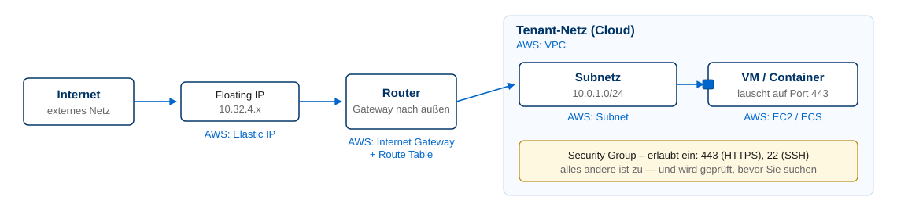

<!-- _class: title -->

# Infrastruktur

## Kapitel 2

Wintersemester 2026/2027
Bachelor AI – Hochschule Fulda
Sebastian Rieger · MMNet

---

## Kapitelübersicht und Lernziele

**Was unter Ihrem Service liegt** — die Perspektive des Providers, nicht die des Netzwerkspezialisten.

Nach diesem Kapitel sollten Sie wissen…

- Was **Redundanz** kostet und welche Rolle sie für Ausfallsicherheit spielt
- Wie eine **Cloud technisch aufgebaut** ist (OpenStack als Beispiel) und was das NetLab leistet
- Welche **Bereitstellungsform** für welchen Dienst sinnvoll ist (Bare Metal → FaaS)
- Was **Storage** und **Netz** in der Cloud bedeuten (Block/File/Object, Security Groups, Floating IPs)
- Welche dieser Bausteine **Ihr Projekt** tatsächlich berührt

> **Ziel:** Sie können beschreiben, was die Plattform leistet, auf der Ihr Dienst läuft — und das in der Dokumentation begründen.

---

## Ausfallsicherheit: was Redundanz kostet

- **Hauptanforderung: Redundanz** — Cluster am lokalen und an potenziellen Failover-Standorten
- Bei externen Anbietern (Hosting/Cloud) heute vergleichsweise leicht realisierbar
- Abwägung **Kosten/Nutzen**: ungerade Anzahl von Komponenten (>1) — aber Redundanz kostet

- Ebenen: Strom/Umgebung · Server · Netzwerk · Storage · Standort · **Anwendung**

> Redundanz ist eine Kostenentscheidung — und Redundanz, die nie getestet wurde, existiert nicht.

🧠 Wo in Ihrem Projekt gibt es aktuell einen Single Point of Failure?

---

## Cloud-Komponenten am Beispiel OpenStack

**Was eine Cloud ausmacht**

- **Controller** (3×, HA): APIs, Scheduler, Datenbank, Message Queue
- **Compute & Storage**: Hypervisor (KVM), Block (Cinder), Objekt (Swift), verteilt (Ceph)
- **Netz & Deployment**: virtuelle Router, Security Groups, Floating IPs; Deployment automatisiert (Ansible)

**Wo das herkommt**

- Controller laufen als **VMs auf Proxmox**, Compute/Storage auf **Bare Metal**
- **Shared Storage (Ceph)** ermöglicht Live-Migration, **redundantes Netz** (MLAG) sichert den Zugriff
- **Provider-Garantie:** API-Verfügbarkeit, Verteilung auf mehrere Nodes, Netztrennung zwischen Mandanten

> **→ umsetzen in:** Die Plattform ist Ihr Fundament — was sie nicht leistet, müssen Sie im Dienst selbst lösen.

---

## NetLab im Vergleich zu Public Clouds

| | NetLab (Private Cloud) | AWS/Azure/GCP (Public Cloud) |
|---|---|---|
| **Kosten** | kostenfrei für Sie, geteilte Ressourcen | nutzungsabhängig, Budget/Credits nötig |
| **Katalog** | kleiner Ausschnitt (Compute, Block/Objekt-Storage, Netz, LB) | hunderte Dienste (verwaltete DBs, Queues, KI-Dienste) |
| **Skalierung** | begrenzt durch die Hardware im Rack | praktisch nur durch Budget begrenzt |
| **Standorte** | ein Standort (Gebäude 46) | Availability Zones und Regions weltweit |
| **Betrieb** | wir (HS Fulda) betreiben und aktualisieren | Provider betreibt, Sie konsumieren |
| **Zugang** | NetLab oder VPN, Floating IPs aus `10.32.4.0/22` | Internet, IAM, Budgets |

- **Konsequenz für Ihr Projekt:** Private Cloud eignet sich für reproduzierbare Basis-Deployments; Public Cloud für Dinge, die Sie selbst nicht betreiben wollen (verwaltete Datenbank, Backup-Ziel).

🧠 Was würden Sie für Ihren Dienst selbst betreiben — und was abgeben?

> **→ umsetzen in:** Lab 2 — dieselbe Instanz einmal in OpenStack, einmal in AWS.

---

## Dimensionierung: Welche Bereitstellungsform?

| Option | Beschreibung | Typischer Einsatz |
|---|---|---|
| **Bare Metal** | Server ohne Virtualisierungsschicht | IO-/GPU-intensiv, spezielle Hardware |
| **VM (IaaS)** | virtuelle Maschine auf Hypervisor | Standard für eigene Dienste, vertraute Betriebsweise |
| **Container** | Prozess-Isolation auf gemeinsamem Kernel | Microservices, reproduzierbare Images |
| **Container-Plattform** | Orchestrierung (Kubernetes, Helm) | Skalierung, Self-Healing, Rolling Updates |
| **FaaS/Serverless** | Funktionen ohne Serververwaltung | ereignisgetrieben, stark schwankende Last |

**Entscheidungskriterien:** Skalierung · Betriebsaufwand · Automatisierbarkeit · Kostenmodell · Persistenz (State) · Compliance

- In dieser LVA ist die **Container-Plattform** der Standardweg; VMs bleiben für Dienste ohne Container-Support eine valide Option.

🧠 Warum ist „Container" nicht automatisch die richtige Antwort?

> **→ umsetzen in:** Labs 1 und 4 — Container bauen, auf einer Plattform betreiben.

---

## Storage: Block, File, Object

**Block**
Festplatte für die VM, per CSI als **PV** im Cluster
Beispiel: Cinder-Volume

**File**
gemeinsames Dateisystem (NAS, NFS)
für mehrere Pods gleichzeitig

**Object**
Zugriff über HTTP-API (S3-ähnlich)
für Backups, Logs, statische Inhalte

- **Lokal/Vernetzt:** DAS (direkt am Server) · SAN (Block über Netz) · NAS (File über Netz) — in der Cloud meist abstrahiert
- **RAID** schützt gegen Plattenausfall, **ist aber kein Backup** — dafür sorgt Kapitel 6
- **Wichtig für Kubernetes:** die **StorageClass** bestimmt, ob ein Volume beim Löschen **erhalten** (`retain`) oder **gelöscht** (`delete`) wird

🧠 Was passiert mit einem Volume, wenn Sie ein Helm-Chart deinstallieren — und warum ist das wichtig?

> **→ umsetzen in:** Lab 4 (PVC/StorageClass) und Lab 6 (Cleanup).

---

## Netz: das Cloud-Netzmodell

In der Cloud bekommen Sie **kein Kabel**, sondern Bausteine — mit den jeweiligen AWS-Entsprechungen:

- **Reihenfolge beim Debuggen:** Läuft der Dienst? → lauscht er auf dem richtigen Port? → erlaubt die Security Group den Port? → ist die Floating IP zugewiesen? → stimmt die Route?
- Kein eigenes VLAN-Trunking, kein IPAM, keine DNS-Zonenverwaltung — das übernimmt der Provider

🧠 Reicht eine Security Group als Firewall für Ihren Dienst?

> **→ umsetzen in:** Lab 2 — Instanz, Floating IP und Security Group bewusst konfigurieren.

---

## Was davon berühren Sie wirklich?

| Plattform-Baustein | Wo Sie damit arbeiten | Was Sie tun müssen |
|---|---|---|
| Instanz/Flavor/Image | Lab 2 | Instanz erstellen, Größe wählen, dokumentieren |
| Netz, Subnetz, Router | Lab 2 | Netz auswählen, IP-Konzept notieren |
| **Security Group** | Lab 2, Lab 4 | Ports öffnen — und nach dem Test wieder schließen |
| **Floating IP** | Lab 2, Lab 4 | zuweisen, dokumentieren, Kosten prüfen |
| **Block-Storage/Cinder** | Lab 4, Lab 6 | StorageClass verstehen, Volume-Reste aufräumen |
| **Load Balancer** | Lab 4 | über den Service/Ingress bereitstellen |
| **Object Storage** | Add-on 8 | Backup-Ziel wählen (z. B. S3-kompatibel) |

💡 Live-Demo: Security Group schließen → `curl` scheitert → wieder öffnen · Kommandos: [OpenStack CLI](https://docs.openstack.org/python-openstackclient/latest/cli/command-list.html) · [kubectl](https://kubernetes.io/docs/reference/kubectl/quick-reference/)

<!-- Fallback, falls die Umgebung nicht erreichbar ist: Screenshots der Horizon-Konsole (Netzwerke, Security Groups) und der Ausgabe von `kubectl get sc,pvc` zeigen. -->

---

## Hintergrund und Vertiefung

**Dokumentation und Nachschlagen**

- 💡 [OpenStack](https://docs.openstack.org/) · [Operations Guide](https://docs.openstack.org/operations-guide/) · [Ceph](https://docs.ceph.com/en/latest/) — Basis der NetLab-Cloud
- 💡 [Proxmox VE](https://www.proxmox.com/en/proxmox-virtual-environment/overview) — Basis unserer Controller-VMs · [AWS Global Infrastructure](https://aws.amazon.com/de/about-aws/global-infrastructure/) — Regions/AZs (aktuelle Zahlen dort)

**Zum Einordnen**

- Warum betreiben wir überhaupt eine eigene Private Cloud? Kosten, Kontrolle, Lehre — eine bewusste Entscheidung
- Was ein Provider garantieren muss, steht im **SLA** (→ Kapitel 3)
- Ausfälle großer Anbieter zeigen: Redundanz über Standorte ist kein theoretisches Szenario

🧠 Wenn Sie die Private Cloud nicht hätten: Welchen Teil Ihres Projekts würden Sie sofort in die Public Cloud verlagern?
